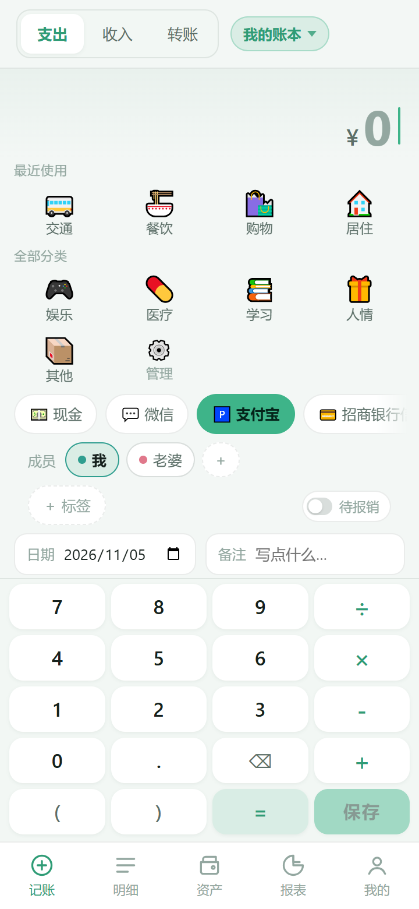
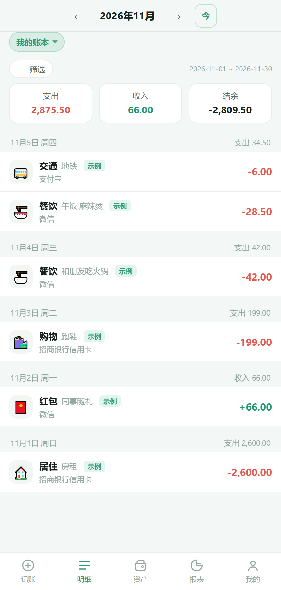
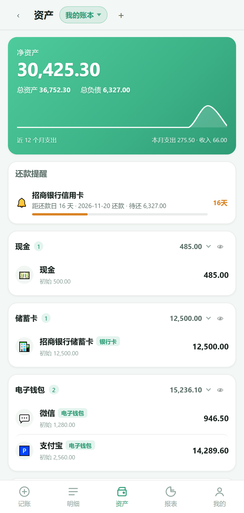
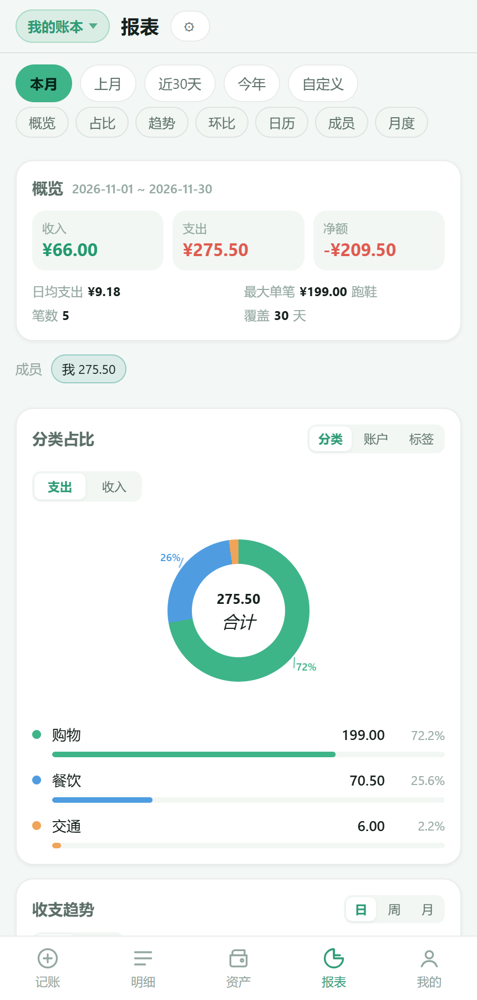
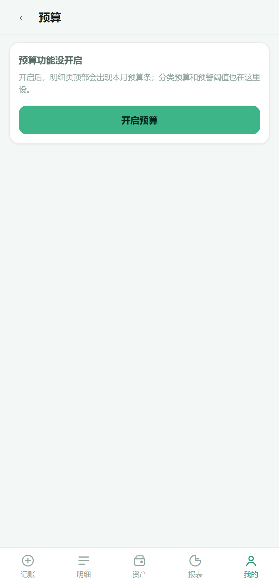
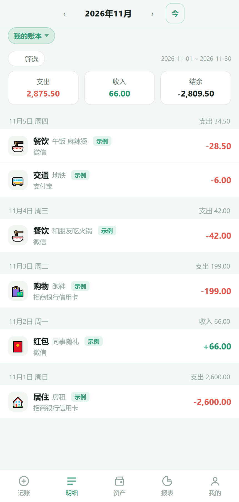

# 丁点记账

> 离线优先的个人记账 App：Android APK（WebView 壳）+ 同一套网页（PWA）+ 可选自建 Node 后端。
> 目标是「丁点大的事也记一笔」——打开就记，不联网也能用，数据在自己手里。

| | |
|---|---|
| 版本 | v1.3.2（versionCode 10） |
| 包体 | 161.6 KB / 165,506 B（APK 里没有框架、没有第三方 SDK） |
| 平台 | Android 7.0+（minSdk 24 / targetSdk 34）；任何现代浏览器也能直接用网页版 |
| 技术栈 | 原生 JS（无构建、无 npm 依赖）· Node 26 + `node:sqlite` · WebView 壳手搓构建（无 Gradle） |
| 许可 | [MIT](LICENSE) |

## 功能（v1.3.2）

- **记账**：四则运算键盘（`12.5+3×2=18.50`）、收入/支出/转账、分类与账户快选、记账页记住上次用的账户与类型、标签、待报销、备注
- **明细**：按日分组 + 小计、月份切换、9 项筛选（类型/账户/分类/标签/成员/关键词/金额区间/日期）、左滑切 tab、右滑返回
- **资产**：一级 tab，按大类分组（现金/银行卡/电子钱包/信用/投资/应收/应付）可折叠可隐藏、净资产 = 资产 − 负债、信用卡额度与**还款提醒**（账单日/还款日/逾期天数）
- **预算**：**功能总开关**（默认关闭，关掉后明细页不显示预算条）、明细页顶部预算条可展开看分类、等式模型「总预算 = 明细合计 + 未分配」、剩余比例低于阈值（默认 10%，可改）时预警、结转下月
- **报表**：本月概览、分类环形图、环比对比、日历热力、近 12 个月走势、按账户/按标签/按成员统计
- **周期记账**：规则列表、开关是**暂停/恢复**（不是删除）、长按才出删除
- **多账本 / 成员**：账本切换、成员 chips（「我」不可删），记账与报表都能按人筛选
- **导入导出**：CSV（默认）/ JSON / **薄荷记账格式**（UTF-16LE + TAB 的 19 列），两边账单可互导，重复导入自动跳过
- **离线优先**：默认本地 IndexedDB，断网、飞行模式都能记；也可以在「我的 → 数据」切到自建服务器模式

## 界面预览（真浏览器截图，430×900@2x）

| 记账 | 明细（预算没开启） | 资产 |
|---|---|---|
|  |  |  |

| 报表 | 预算（未开启） | 预算（已开启） |
|---|---|---|
|  |  |  |

更多截图见 [`docs/shots-v13/`](docs/shots-v13/)、[`docs/shots-v12/`](docs/shots-v12/)、[`docs/shots-v122/`](docs/shots-v122/)。

## 三种用法

```bash
git clone https://github.com/Beginners-debug/dingdian-jizhang.git
```

### 1. 装 APK（推荐，手机上）

从 [Releases](https://github.com/Beginners-debug/dingdian-jizhang/releases/latest) 下载 `dingdian-1.3.2.apk`，或自己构建：

```powershell
# 首次需要工具链（JDK 17 + Android SDK build-tools，脚本会自己下载到 android/.toolchain，约 1 GB）
powershell -ExecutionPolicy Bypass -File android\build.ps1
# 之后改完 web/ 再打包（约 6 秒）
powershell -ExecutionPolicy Bypass -File android\build.ps1 -SkipToolchain
```

产物在 `android/dist/`，签名用 `android/keystore/`（**仓库里不含私钥**，见 [`android/README.md`](android/README.md) 生成自己的）。

### 2. 手机浏览器直接开（不装 App）

```powershell
node server/src/server.js      # 起在 0.0.0.0:8787，控制台会打印局域网地址
```

手机连同一个 WiFi，浏览器打开 `http://<电脑IP>:8787/`，可以「添加到主屏幕」，用起来和 App 一样（Service Worker 缓存，之后断网也能开）。

### 3. 纯静态托管网页版

`web/` 是纯静态的，扔到任何静态服务器 / GitHub Pages 都行：

```powershell
node -e "const h=require('http'),f=require('fs'),p=require('path');h.createServer((q,s)=>{let u=q.url.split('?')[0];if(u==='/')u='/index.html';const t=p.join('web',u);f.readFile(t,(e,d)=>e?(s.writeHead(404),s.end()):(s.writeHead(200,{'Content-Type':t.endsWith('.js')?'text/javascript':t.endsWith('.css')?'text/css':'text/html; charset=utf-8'}),s.end(d)))}).listen(8080,()=>console.log('http://127.0.0.1:8080'))"
```

> 网页版默认走本地 IndexedDB；要连后端就在「我的 → 数据」里切「服务器模式」并填地址（默认取当前域名）。

## 目录

```
web/                    前端（PWA，纯静态，无构建）
  index.html  app.js  styles.css  sw.js  manifest.webmanifest
  js/  money.js 四则运算 · stats.js 聚合 · store*.js 存储适配器 · mint.js 导入导出
server/                 后端（Node 26，零依赖）
  src/db.js 建表/迁移/种子 · src/auth.js scrypt+HMAC · src/server.js REST + 静态托管
  test/smoke.mjs        169 条断言（自起进程 + 独立临时库）
android/                WebView 壳（无 Gradle，手搓 aapt2/javac/d8/zipalign/apksigner）
  app/src/com/mintlite/app/MainActivity.java  拦截请求读 assets/www + JS 桥
  build.ps1             一条命令出签名 APK
tools/verify/           14 个验收脚本（CDP 无头浏览器 + 接口直连）
docs/                   计划、逐版契约、截图
```

## 开发

```powershell
# 后端 + 冒烟
node server/src/server.js
node server/test/smoke.mjs            # PASS 169/169

# 前端（改完直接刷新，没有构建步骤）
node tools/verify/class-cov.cjs web/app.js web/styles.css   # 检查有没有漏写样式
node tools/verify/cdp.mjs "http://127.0.0.1:8787/" out.png tools/verify/lead-e2e-v13.js 430 900
```

验收脚本清单和用法见 [`tools/verify/README.md`](tools/verify/README.md)；每一版的接口契约见 [`docs/`](docs/)，例如 [`docs/CONTRACT-v1.3.2.md`](docs/CONTRACT-v1.3.2.md)。

## 数据与隐私

- 默认**只存在手机本地**（IndexedDB / APK 里的 WebView 存储），不上传任何服务器
- 用服务器模式时数据存在你自己跑的 `server/data/mintlite.db`（SQLite），登录口令用 scrypt 加盐存哈希
- 仓库里**不包含**任何数据库、签名私钥、token
- 备份三件事：`我的 → 数据 → 导出 JSON`、`android/keystore/`、`server/data/mintlite.db`

## 说明

- 包名仍是 `com.mintlite.app`，本地存储键仍以 `mintlite:` 开头、JS 桥仍叫 `MintLiteBridge`：这些是内部标识，改名会让已装应用丢数据，所以只改了显示名
- 灵感与功能对照来自「薄荷记账」，本项目是独立实现，与其无关联
- 真机冒烟：本项目开发环境没有安卓设备，APK 的验证靠 `apksigner` / `aapt2 badging` / 包内资源 SHA-256 比对 + 前端在真浏览器的 E2E；你装到手机上遇到问题请提 issue

## License

[MIT](LICENSE) © 2026 丁点记账
